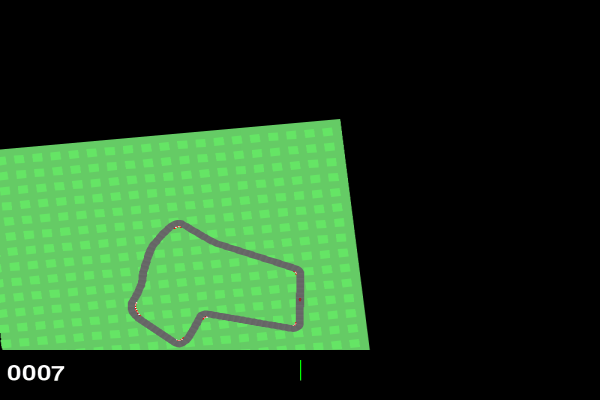
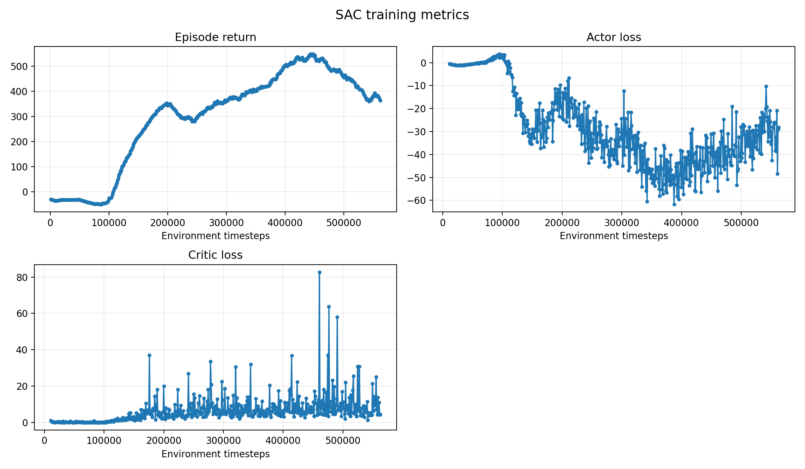

# CarRacing RL

A portfolio-oriented reinforcement-learning project using pixel observations
from Gymnasium's `CarRacing-v3`. It compares PPO, a standard pixel-based SAC
baseline, and a DrQ-SAC variant with task-specific reward shaping.

## Results

The strongest policies are shown below on the shared demo seed `48`.

<table>
  <tr>
    <th>PPO stabilized continuation</th>
    <th>SAC</th>
    <th>DrQ-SAC</th>
  </tr>
  <tr>
    <td>
      
      <br><strong>855.7 ± 81.3 holdout return</strong>
    </td>
    <td>
      
      <br><strong>516.5 ± 262.5 holdout return</strong>
    </td>
    <td>
      
      <br><strong>806.1 ± 94.8 holdout return</strong>
    </td>
  </tr>
</table>

The table reports deterministic evaluation on 50 fresh seeds (`100–149`),
separate from the five seeds used for checkpoint selection. 

| Model | Training steps | Training time | Holdout return | Lap completion |
| --- | ---: | ---: | ---: | ---: |
| PPO original | 1.20 M | 1h 52min | 847.8 ± 40.0 | 4/50 (8.0%) |
| PPO stabilized continuation | 1.32 M | ~2h 26min | 855.7 ± 81.3 | 9/50 (18.0%) |
| SAC | 262 k | 3h 50min | 516.5 ± 262.5 | 2/50 (4.0%) |
| DrQ-SAC | 420 k | 4h 47min | 806.1 ± 94.8 | 1/50 (2.0%) |

The PPO, SAC, and DrQ-SAC checkpoints were selected using the original
five-seed validation set; the holdout seeds were not used for selection.

## Approach

A standard pixel-based SAC baseline learned slowly and remained less consistent
than PPO and DrQ-SAC. We introduced DrQ-SAC with image augmentation and shaped
rewards. The shaping encourages throttle use, forward speed, and acceleration,
while discouraging exploitation strategies such as driving in circles by
penalizing prolonged steering in the same direction. No-progress behavior is
also penalized. Increasing `batch_size` and `buffer_size` was also important
for successful training, but higher values are not possible in the local setup.

Both SAC variants use a 10,000-step warmup. Standard SAC samples steering, gas,
and brake independently and uniformly from the full action space, so gas and
brake can be active at the same time. DrQ-SAC uses structured warmup instead:
steering is small 80% of the time and full-range 20% of the time; throttle is
active 75% of the time and brake 25% of the time, never simultaneously. These
actions are sampled independently at each step, so the warmup is not smooth or
corner-aware and provides little sustained cornering behavior. The policy must
learn that after warmup. Structured action injection is disabled after warmup
in the current configuration (`exploration_probability=0.00`). The DrQ-SAC 
variant learns significantly faster.

PPO was straightforward to train and much faster, but its policy degraded after 
reaching a strong result. We resumed from the best PPO checkpoint with a lower
learning rate, tighter policy updates, and reduced action standard deviation.
This stabilized continuation produced a modest improvement, while the earlier
best checkpoint remained protected.

## Training Curves

The PPO plot combines the original run through 1.2M steps with the stabilized
continuation. The phase boundary marks the lower learning rate, tighter PPO
clipping, KL target, and reduced action standard deviation.


SAC has a very slow training curve with no significant progress in the first ~100k steps 
but then improved steadily and reached its peak at ~450k steps. After that the agent 
degraded. 



DrQ-SAC trained significantly faster, reaching strong results after ~150k steps, although
with significant dispersion and struggled to improve significantly after that.


## Technical Highlights

- PPO uses one RGB frame and native continuous three-action control.
- SAC and DrQ-SAC use four stacked RGB frames.
- DrQ-SAC applies independent random image shifts with batched PyTorch
  operations.
- The DrQ-SAC critic owns the image encoder; the actor reuses its features.
- Validation uses deterministic actions in fresh environments.
- Best checkpoints are retained because continued PPO training can degrade a
  previously strong policy.
- Changing DrQ-SAC reward semantics while reusing an actor, critic, and replay
  buffer caused catastrophic forgetting in exploratory runs, so reward changes
  require a fresh run.

## Protocol

- Environment: `CarRacing-v3`, continuous native three-action control.
- Training seed: `42`.
- Validation seeds: `43, 44, 45, 46, 47`.
- Demonstration seed: `48`.
- Device: CPU.
- Generated models, replay buffers, TensorBoard logs, plots, and GIFs are stored
  in the ignored `outputs/` directory.

## Reproduction

The repository was developed for CPU experiments. These commands are included
for reference; the main purpose of the project is to document the experiments
and their results.

<details>
<summary>Show setup and commands</summary>

```bash
python -m pip install -r requirements.txt

python main.py check
python main.py smoke --algorithm PPO
python main.py train --algorithm PPO --timesteps 204800
python main.py train --algorithm PPO --timesteps 204800 --resume
python main.py evaluate --algorithm PPO --checkpoint best
```

`train` starts fresh by default and removes that algorithm's generated output
directory. `--resume` loads `latest_checkpoint/`. PPO continuation uses the
resume-only stabilization settings in `experiment_config.json`: learning rate
from `1e-4` to `2e-5`, `clip_range=0.1`, `target_kl=0.02`, and action standard
deviation capped near `0.5`.
</details>

## Repository Checks

```bash
python -m py_compile experiment.py main.py drq_sac.py plot_tensorboard.py
```

## License

MIT. See `LICENSE`.
