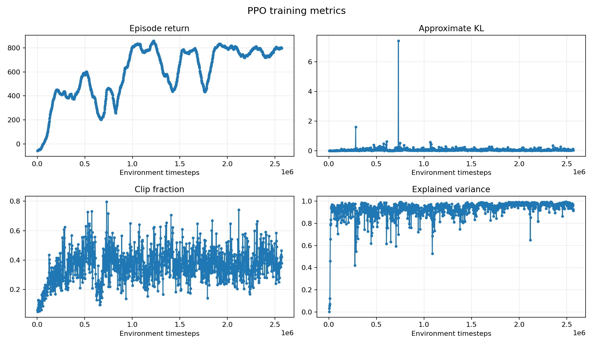
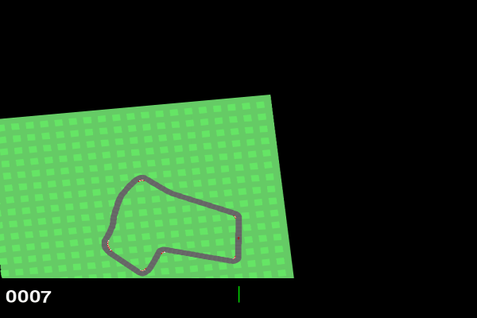

# CarRacing RL

Small, reproducible reinforcement-learning experiments on Gymnasium's
`CarRacing-v3`. The project compares an on-policy baseline with two pixel-based
off-policy variants:

- **PPO**: default environment reward and native RGB observations.
- **SAC**: default reward with four stacked RGB frames. This is intentionally a
  negative baseline for ordinary pixel SAC.
- **DrQ-SAC**: four stacked frames, random-shift augmentation, and a fixed
  forward-driving reward-shaping recipe.

The algorithms are trained independently. Checkpoint selection uses the mean
deterministic original CarRacing return on validation seeds, not the shaped
reward or the latest training step.

## Setup

```bash
python -m pip install -r requirements.txt
```

The experiments were developed for CPU execution. Training CarRacing from
pixels is slow; the commands below are intended to make short verification
runs and explicit continuation safe rather than hide the compute cost.

## Commands

```bash
# Verify the installed environment and action/observation spaces.
python main.py check

# Fresh smoke tests. Existing output for that algorithm is replaced.
python main.py smoke --algorithm PPO
python main.py smoke --algorithm SAC
python main.py smoke --algorithm DRQ-SAC

# Start a fresh run.
python main.py train --algorithm PPO --timesteps 204800

# Continue only when requested explicitly.
python main.py train --algorithm PPO --timesteps 204800 --resume

# Evaluate a saved checkpoint without training.
python main.py evaluate --algorithm PPO --checkpoint best
python main.py evaluate --algorithm SAC --checkpoint best
python main.py evaluate --algorithm DRQ-SAC --checkpoint best
```

`train` starts fresh by default and removes that algorithm's generated output
directory before training. `--resume` loads `latest_checkpoint/`; for SAC and
DrQ-SAC this includes the replay buffer. `smoke` is always fresh.

## Protocol

- Environment: `CarRacing-v3`, continuous native three-action control.
- Training seed: `42`.
- Validation seeds: `43, 44, 45, 46, 47`.
- Demonstration seed: `48`.
- Device: CPU.
- PPO uses one RGB frame; SAC and DrQ-SAC use four stacked frames.
- Evaluation is deterministic and uses fresh environments.
- Generated models, replay buffers, TensorBoard logs, plots, and GIFs live in
  `outputs/`, which is intentionally ignored by Git.

## Representative Results

| Algorithm | Training steps | Validation return |
| --- | ---: | ---: |
| PPO | 1,198,080 | `831.1 +/- 26.0` |
| SAC | 40,000 | `-26.5 +/- 16.6` |
| DrQ-SAC | 420,000 | `796.1 +/- 37.0` |

These are representative CPU runs, not a claim of convergence or universal
algorithm superiority. PPO and DrQ-SAC learned useful driving in this setup;
ordinary pixel SAC did not bootstrap coordinated steering and acceleration.
The timestep budgets and compute costs differ substantially, so this is an
engineering comparison rather than a controlled scaling study.

DrQ-SAC's reward shaping is an auxiliary training objective. Its shaped return
must not be compared directly with PPO or SAC; checkpoint selection and the
table above use original CarRacing return.

## Samples




Best validation-selected checkpoints evaluated on the shared demo seed `48`:

<table>
  <tr>
    <th>PPO</th>
    <th>DrQ-SAC</th>
  </tr>
  <tr>
    <td></td>
    <td></td>
  </tr>
</table>

## Implementation Notes

- `drq_sac.py` applies independent random image shifts with batched PyTorch
  `unfold`, avoiding a Python loop over replay samples.
- The critic owns the DrQ image encoder. The actor reuses its features so the
  encoder is trained by the critic objective only.
- Interrupted off-policy runs save `latest_checkpoint/model.zip` and one
  matching `replay_buffer.pkl`.
- The best checkpoint is retained because continued PPO training can degrade a
  previously strong policy.
- Changing DrQ-SAC reward semantics while reusing an actor, critic, and replay
  buffer caused catastrophic forgetting in exploratory runs. Start a fresh run
  when changing reward coefficients.

## Repository Checks

```bash
python -m py_compile experiment.py main.py drq_sac.py plot_tensorboard.py
```

## License

MIT. See `LICENSE`.
