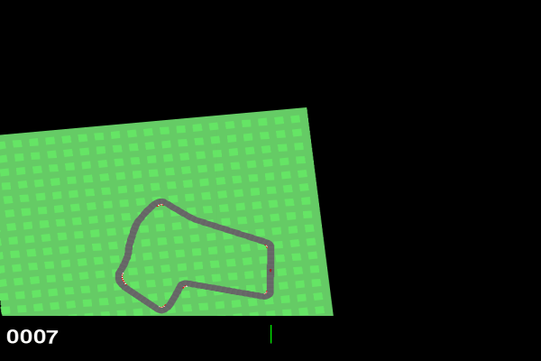
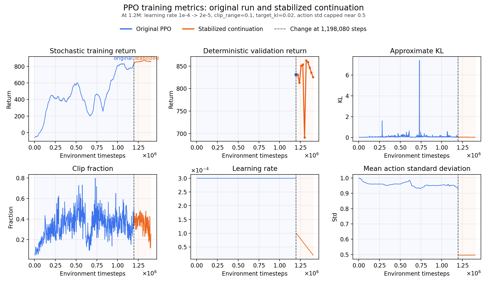
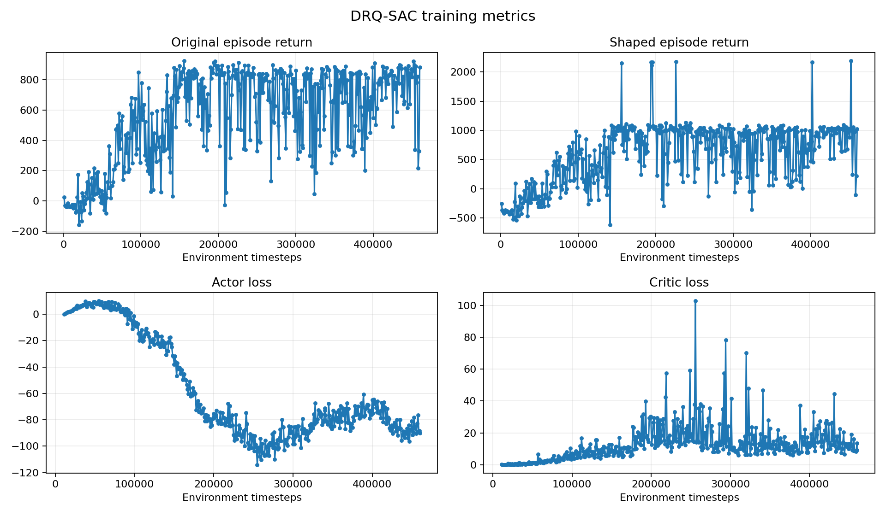

# CarRacing RL

A portfolio-oriented reinforcement-learning project using pixel observations
from Gymnasium's `CarRacing-v3`. It compares PPO, a standard pixel-based SAC
baseline, and a DrQ-SAC variant with task-specific reward shaping.

## Results

The strongest policies are shown below on the shared demo seed `48`.

<table>
  <tr>
    <th>PPO stabilized continuation</th>
    <th>DrQ-SAC</th>
  </tr>
  <tr>
    <td>
      
      <br><strong>862.7 +/- 20.4 validation return</strong>
    </td>
    <td>
      
      <br><strong>796.1 +/- 37.0 validation return</strong>
    </td>
  </tr>
</table>

Checkpoint selection uses the mean deterministic original CarRacing return on
five validation seeds. DrQ-SAC's shaped return is only a training objective and
is not compared with PPO or SAC.

| Model | Training steps | Training time | Validation return |
| --- | ---: | ---: | ---: |
| PPO original | 1.20 M | 1h 52min | 831.1 ± 26.0 |
| PPO stabilized continuation | 1.32 M | ~2h 26min | 862.7 ± 20.4 |
| DrQ-SAC | 420 k | 4h 47min | 796.1 ± 37.0 |

The stabilized PPO time includes the original run and the recorded continuation
used to select the best checkpoint; the checkpoint was selected before that
continuation finished.

## Approach

A standard pixel-based SAC baseline did not learn useful driving in this setup.
It failed to coordinate steering and acceleration, so we introduced DrQ-SAC with
image augmentation and shaped rewards. The shaping encourages throttle use,
forward speed, and acceleration, while discouraging exploitation strategies
such as driving in circles by penalizing prolonged steering in the same
direction. No-progress behavior is also penalized. Increasing `batch_size` and
`buffer_size` was also important for a successful training, but higher values 
are not possible in the local setup. 

PPO was comparatively straightforward to train and much faster, but its policy 
degraded after reaching a strong result. We resumed from the best PPO checkpoint with a lower
learning rate, tighter policy updates, and reduced action standard deviation.
This stabilized continuation produced a modest improvement, while the earlier
best checkpoint remained protected.

## Training Curves

The PPO plot combines the original run through 1.2M steps with the stabilized
continuation. The phase boundary marks the lower learning rate, tighter PPO
clipping, KL target, and reduced action standard deviation.





## Technical Highlights

- PPO uses one RGB frame and native continuous three-action control.
- SAC and DrQ-SAC use four stacked RGB frames.
- DrQ-SAC applies independent random image shifts with batched PyTorch
  operations.
- The DrQ-SAC critic owns the image encoder; the actor reuses its features.
- Validation uses deterministic actions in fresh environments.
- Best checkpoints are retained because continued PPO training can degrade a
  previously strong policy.
- Changing DrQ-SAC reward semantics while reusing an actor, critic, and replay
  buffer caused catastrophic forgetting in exploratory runs, so reward changes
  require a fresh run.

## Protocol

- Environment: `CarRacing-v3`, continuous native three-action control.
- Training seed: `42`.
- Validation seeds: `43, 44, 45, 46, 47`.
- Demonstration seed: `48`.
- Device: CPU.
- Generated models, replay buffers, TensorBoard logs, plots, and GIFs are stored
  in the ignored `outputs/` directory.

## Reproduction

The repository was developed for CPU experiments. These commands are included
for reference; the main purpose of the project is to document the experiments
and their results.

<details>
<summary>Show setup and commands</summary>

```bash
python -m pip install -r requirements.txt

python main.py check
python main.py smoke --algorithm PPO
python main.py train --algorithm PPO --timesteps 204800
python main.py train --algorithm PPO --timesteps 204800 --resume
python main.py evaluate --algorithm PPO --checkpoint best
```

`train` starts fresh by default and removes that algorithm's generated output
directory. `--resume` loads `latest_checkpoint/`. PPO continuation uses the
resume-only stabilization settings in `experiment_config.json`: learning rate
from `1e-4` to `2e-5`, `clip_range=0.1`, `target_kl=0.02`, and action standard
deviation capped near `0.5`.
</details>

## Repository Checks

```bash
python -m py_compile experiment.py main.py drq_sac.py plot_tensorboard.py
```

## License

MIT. See `LICENSE`.
